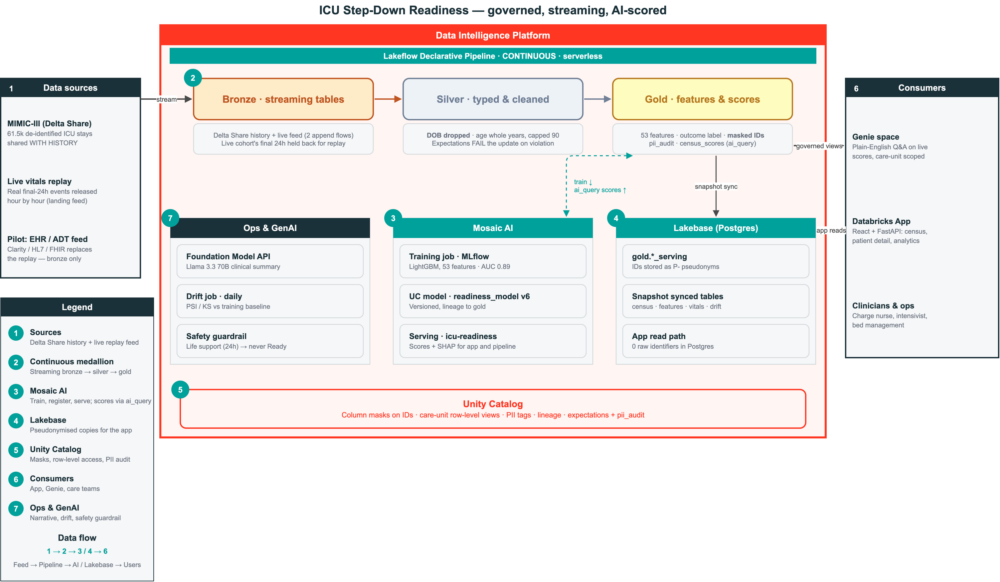
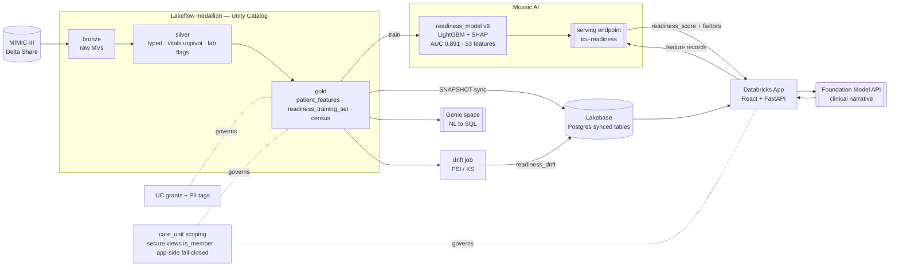

# Architecture — ICU Step-Down Readiness

End-to-end, fully Databricks-native journey. One governed gold feature set feeds
the model, the app, and Genie. Provided **both** as a rendered image
([`architecture.png`](architecture.png)) and as the **Mermaid text below** — the
repo collector excludes binary images, so the text version is the one guaranteed
to reach reviewers.

## Layer notes

- **bronze** — raw MIMIC-III tables as STREAMING TABLES reading Delta Share history (CONTINUOUS mode). Landing stage holds frozen cohort (`live_cohort`) and real chart-event replays (`chart_events_feed`).
- **silver** — typed/cleaned; `chart_events` unpivoted to a long `vital_signs` stream (ITEMID→vital_name, °F→°C, physiologic range filters); `lab_events` `is_lactate` flag; DOB dropped, age capped at 90. See [`../DATA-JOURNEY.md`](../DATA-JOURNEY.md).
- **gold** — 24h feature engineering (53 features, v6) → `patient_features` → `readiness_training_set` (safe = alive + no readmission + no death in 72h; n=61,492) and `census` (40 current); derived guardrail signals, synthetic `care_unit`, and pseudonymized serving tables. `pii_audit` scans for forbidden columns (DOB, raw identifiers).
- **serving** — LightGBM v6 readiness model (headline AUC 0.891; readmission-only 0.635) behind a Mosaic AI endpoint; returns a score + SHAP factors, with the always-flag-known-risks safety override. Model serves via UC column-masked tables (pseudonym for non-admins) to maintain identity governance.
- **narrative** — Foundation Model API turns score + factors into a clinician summary.
- **Genie** — three governed tables exposed for NL Q&A (see [`06-genie.md`](06-genie.md)).
- **Lakebase** — gold synced to Postgres (SNAPSHOT) with pre-pseudonymized serving tables (`census_serving`, `patient_features_serving`) to avoid double-masking; Postgres holds 0 raw identifiers.
- **app** — ranked census, patient detail, analytics; reads Lakebase + serving. Analytics card shows AUC 0.89, readmission-only AUC 0.63, footer "Model v6".
- **drift** — live vs training score distribution (PSI/KS) written back to gold, synced to Lakebase, surfaced in the app.
- **governance** — UC grants/PII tags + UC column masks + `care_unit` scoping (UC secure views via `is_member()`, UC column masks for identifiers, and fail-closed app-side enforcement on the Lakebase path). PII masking applied before the pipeline via `src/governance/pii_masking.sql`.
